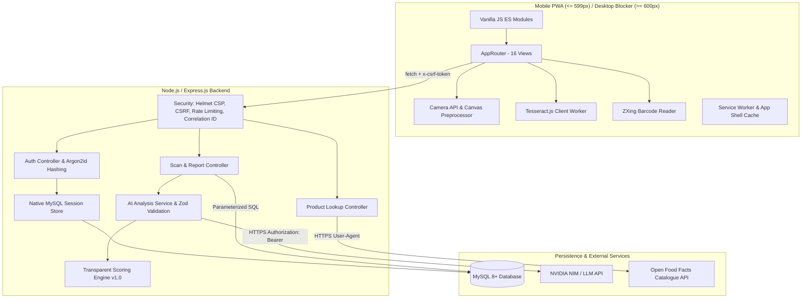
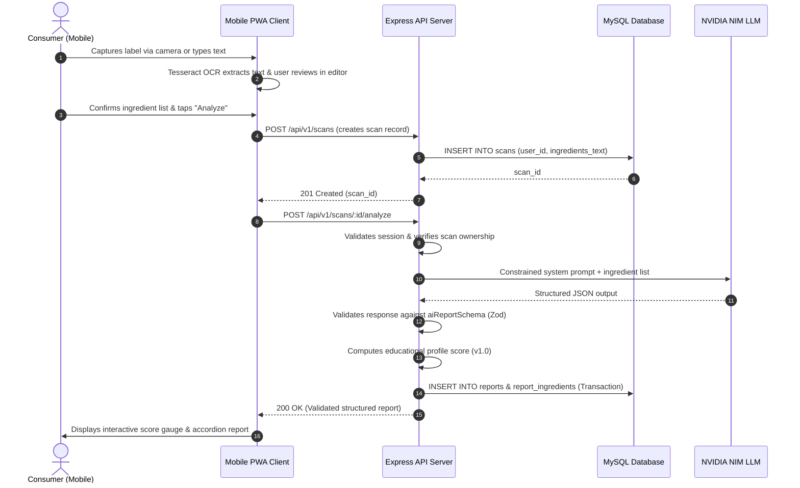

# ScanBeforeEat — System Architecture

## 1. High-Level Architecture Overview

---

## 2. Layer Responsibilities

### 2.1 Client Layer (`client/`)
- **Vanilla ES Modules**: No heavy frontend framework runtime; zero compilation overhead; native browser loading.
- **Progressive Web App**: Manifest (`manifest.webmanifest`), service worker (`service-worker.js`), offline fallback.
- **Mobile-First & Desktop Blocker**: Viewport enforcement via CSS media queries (`max-width: 599px`) and programmatic JavaScript window listener.
- **Client-Side Image Preprocessing**: Downscales and enhances contrast on `<canvas>` before feeding images into Tesseract.js.

### 2.2 Server Architecture (`server/`)
- **`server/app.js`**: Express configuration, Helmet with tailored Content Security Policy, rate limiting, and static serving.
- **`server/config/`**: Zod environment validation (`env.js`) and MySQL connection pool (`database.js`).
- **`server/middleware/`**:
  - `session-store.js`: Custom MySQL session store replacing vulnerable external packages.
  - `csrf.middleware.js`: Cryptographic CSRF token validation.
  - `auth.middleware.js`: Multi-tenant ownership verification (`checkOwnership`).
  - `rate-limit.middleware.js`: Segmented rate limiters for auth, AI, and barcodes.
  - `correlation-id.middleware.js`: Request correlation ID tracking.
- **`server/services/`**:
  - `ai.service.js`: NVIDIA NIM API client with bounded retries, prompt-injection defenses, and mock fallback.
  - `scoring.service.js`: Versioned transparent product scoring algorithm.
  - `product-data.service.js`: Open Food Facts API integration and MySQL caching.
- **`server/repositories/`**: Parameterized SQL query abstractions for `users`, `scans`, and `reports`.

---

## 3. Data Flow: End-to-End Scan & Analysis Lifecycle

