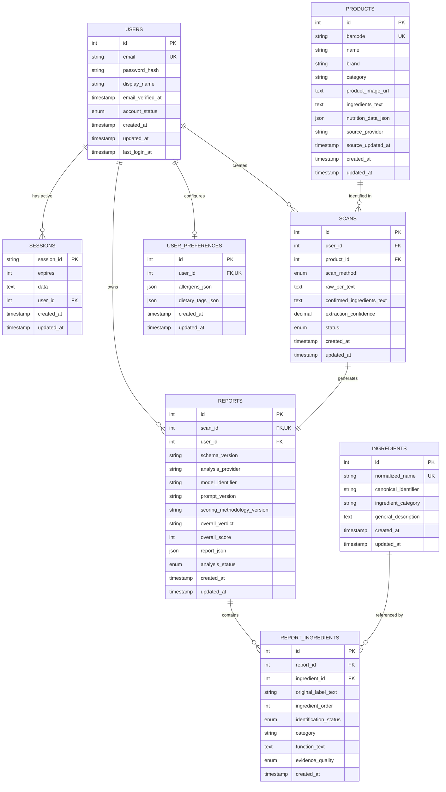

# ScanBeforeEat — Database Architecture & ER Guide

## 1. Relational Entity Relationship Diagram

## 2. Table Specifications & Indexing Strategy

### 2.1 `users`
- **Engine**: InnoDB, `utf8mb4_unicode_ci`
- **Primary Key**: `id` (Auto-increment)
- **Unique Indexes**: `email` (normalized to lowercase)
- **Indexes**: `account_status`
- **Security**: Never store plaintext passwords; hashed with `argon2id`.

### 2.2 `sessions`
- **Engine**: InnoDB, `utf8mb4_unicode_ci`
- **Primary Key**: `session_id` (VARCHAR 128)
- **Indexes**: `expires` (for fast timer-based cleanup queries), `user_id` (for session invalidation on password change or account deletion)
- **Storage**: Full JSON session data serialized in `data` MEDIUMTEXT column.

### 2.3 `products`
- **Primary Key**: `id`
- **Unique Indexes**: `barcode` (nullable, allows non-barcode items while preventing duplicate barcodes)
- **Indexes**: `name`, `category`
- **Caching**: Stores cached responses from Open Food Facts API with `source_updated_at`.

### 2.4 `ingredients`
- **Primary Key**: `id`
- **Unique Indexes**: `normalized_name`
- **Indexes**: `canonical_identifier` (INS / E-numbers), `ingredient_category`
- **Purpose**: Canonical registry of recognized food ingredients across scans.

### 2.5 `scans`
- **Primary Key**: `id`
- **Foreign Keys**: 
  - `user_id` -> `users(id)` ON DELETE CASCADE
  - `product_id` -> `products(id)` ON DELETE SET NULL
- **Indexes**: `user_id`, `created_at`, `status`
- **Isolation**: Every query filters by `user_id = ?` to guarantee multi-tenant data boundaries.

### 2.6 `reports`
- **Primary Key**: `id`
- **Foreign Keys**:
  - `scan_id` -> `scans(id)` ON DELETE CASCADE (1:1 relationship enforced via UNIQUE constraint)
  - `user_id` -> `users(id)` ON DELETE CASCADE
- **Indexes**: `user_id`, `created_at`, `overall_verdict`, `overall_score`
- **Columns**: Full structured AI payload in `report_json` (JSON), with queryable summary columns (`overall_verdict`, `overall_score`).

### 2.7 `report_ingredients`
- **Primary Key**: `id`
- **Foreign Keys**:
  - `report_id` -> `reports(id)` ON DELETE CASCADE
  - `ingredient_id` -> `ingredients(id)` ON DELETE SET NULL
- **Indexes**: `report_id`, `ingredient_id`

### 2.8 `user_preferences`
- **Primary Key**: `id`
- **Foreign Keys**: `user_id` -> `users(id)` ON DELETE CASCADE (1:1 relationship)

## 3. MySQL Workbench Inspection Instructions

1. Open **MySQL Workbench**.
2. Click **Database** -> **Reverse Engineer...** (or press `Cmd + R` on macOS).
3. Connect using:
   - Hostname: `127.0.0.1` (or local socket `/tmp/mysql_brew.sock`)
   - Port: `3306`
   - User: `scanbeforeeat_app`
   - Password: `scanbeforeeat_dev_2026`
4. Select database `scanbeforeeat`.
5. Click **Execute** to generate the interactive visual ER diagram.
